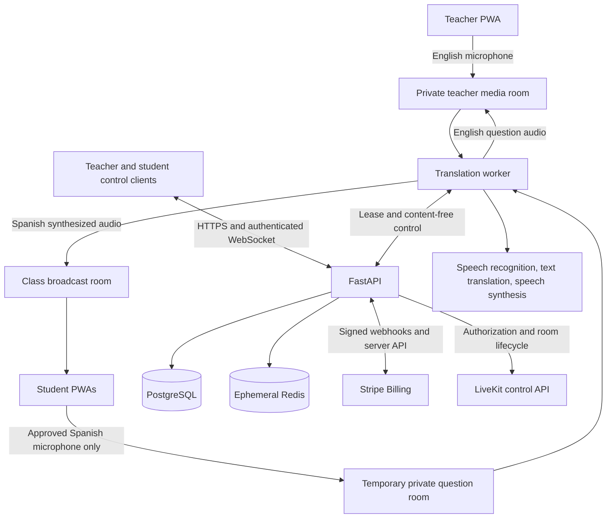

# 02 - Architecture, repository, and data model

## 1. Architecture choice
Build one installable web client, one application backend, and a separately deployable long-running translation worker. Prefer a modular monolith over many microservices. LiveKit handles realtime media transport; the worker handles interpretation. FastAPI handles control, authorization, billing integration, and metadata. PostgreSQL is durable truth; Redis is transient coordination/cache, not the sole ledger.

| Layer | Choice | Responsibility |
| --- | --- | --- |
| Client | React, TypeScript, Vite, React Router, TanStack Query | PWA, teacher/student UI, browser media, localized strings. |
| UI primitives | Accessible headless components, CSS variables, Lucide icons | Consistent keyboard/mobile behavior; approved branding. |
| API | FastAPI, Pydantic, SQLAlchemy, Alembic | Auth boundary, sessions, permissions, billing, usage, glossary. |
| Auth | Supabase email OTP through backend | Verified adult sign-in; app-local secure session. |
| Database | PostgreSQL | Tenants, accounts, metadata, subscriptions, usage, jobs, audits. |
| Transient state | Redis with persistence disabled for classroom content | Caption snapshots, live events, leases, short-lived question text. |
| Media | LiveKit Cloud | Separate broadcast, teacher, and temporary question rooms. |
| Worker | Python asyncio + LiveKit RTC SDK | Audio ingestion, STT, bounded segmentation, translation validation, TTS, shared output. |
| Billing | Stripe hosted Checkout + Billing + Customer Portal | Trial, subscription, invoices, payment method, cancellation. |
| Email | Verified SMTP/transactional provider; local Mailpit | Auth delivery and essential account notices. |
| Quality | pytest, Vitest, Playwright, accessibility checks | Unit, integration, browser, billing, abuse and media tests. |

Use maintained compatible releases selected at implementation time. Commit `pnpm-lock.yaml`, Python lockfile, container tags/digests, and a tested provider/API version record. Do not blindly choose `latest` in deployment manifests. Python 3.12+ is a compatibility target, not a reason to ignore current SDK requirements.

No Flask alongside FastAPI, no vector database, no LangChain requirement, no chatbot agent loop, no Kubernetes prerequisite. Optional future substitutions require a short architecture decision record and retained acceptance tests.

## 2. Logical topology

This is a proposed design, not a vendor-provided reference architecture. The extra private rooms cost participant connections but avoid relying on a student's UI to hide raw/private audio.

## 3. Media trust boundaries
Each classroom has:
- `broadcast_room`: the worker publishes Spanish output; admitted students subscribe only. No student or teacher source audio is published here.
- `teacher_room`: exactly the authorized teacher and worker. Teacher publishes the English microphone; worker publishes the private English interpretation of approved student questions.
- `question_room`: created for a single approved question turn; exactly the selected student and worker. Student may publish microphone audio, cannot subscribe to other tracks, and must explicitly tap Speak. Delete the room when the turn is completed/revoked.

All room names and participant identities are random opaque values, not student names, parish names, emails, join codes, or session titles. Provider tokens contain only required grants. The room mapping never comes from a client-controlled room-name string. LiveKit token/grant and room-control capabilities are documented in [S10-S11].

Server controls who gets each room token. LiveKit grants forbid cameras, screenshares, and client data publication. Broadcast clients have no publish grants. A malicious browser cannot receive a token for the private teacher/question room. Client `autoSubscribe=false` is an efficiency setting, not a privacy boundary.

The worker uses a distinct identity for each room connection and selects tracks from authenticated source identities. Never transcribe its own TTS output. Instructor and students are not given room-admin keys. If runtime microphone grants change, use the server participant API and revoke/close old room access; do not merely change a React button. LiveKit Cloud provides token revocation behavior that a self-hosted test deployment may not provide [S10].

The teacher's answer is classroom-wide in Spanish. The student question's English interpretation is teacher-only. Explain this distinction in UI/help; do not promise confidentiality from people physically in the room.

## 4. Repository to create
```text
babelbeam/
  AGENTS.md
  .cursor/rules/
  .env.example
  apps/web/
    src/app/                  routes, layouts, providers
    src/features/             auth, onboarding, classroom, listener, glossary, billing
    src/components/           accessible shared UI
    src/lib/                  api, media, event schemas, error handling
    src/locales/              en.json, es.json
    public/brand/             clean production logo variants
    public/icons/             PWA and Apple icons
    public/manifest.webmanifest
  services/backend/
    app/api/                  versioned HTTP/WebSocket routes
    app/core/                 config, auth, authorization, telemetry
    app/models/               SQLAlchemy models
    app/schemas/              Pydantic contracts
    app/services/             billing, entitlements, classes, glossary, usage
    app/providers/            Stripe, LiveKit, Auth, email adapters
    app/jobs/                 durable metadata jobs and outbox handlers
    migrations/
    tests/
  services/worker/
    worker/main.py
    worker/rooms.py
    worker/pipeline.py
    worker/segmenter.py
    worker/terminology.py
    worker/providers/         real and test STT/translation/TTS adapters
    worker/prompts/
    worker/tests/
  packages/contracts/         generated OpenAPI types + checked event schema
  config/                     plan definitions; no credentials
  fixtures/                   synthetic text/audio test inputs only
  design/
  infra/                      local compose, production container/proxy templates
  scripts/                    migrations, model checks, seed, billing simulation
  docs/                       specs, status, tested versions, runbooks
```
The files supplied in this kit are the specifications, not existing runtime directories. Agent must create and test the implementation.

## 5. Durable schema
Use UUIDs, UTC `timestamptz`, integer monetary cents, integer usage seconds, explicit foreign keys and indexes, and migration-managed enums/checks. Avoid a table named `sessions` for both login and classes.

| Table | Minimum fields and rules |
| --- | --- |
| `users` | id, external_auth_subject UNIQUE, verified_email, display_name, status, created_at; never trust a supplied role. |
| `organizations` | id, name, timezone, owner_user_id, created_at, minors_enabled default false, status. |
| `memberships` | organization_id, user_id, role owner/teacher; UNIQUE pair; one instructor seat under proposed plan. |
| `auth_sessions` | hashed opaque token, user_id, last_auth_at, idle/absolute expiry, revoked_at; no raw bearer tokens in DB. |
| `subscription_records` | org_id, stripe_customer_id UNIQUE, stripe_subscription_id UNIQUE, price_id, status, trial_start/end, paid_through, cancel_at, cancel_at_period_end, last_reconciled_at. |
| `trial_claims` | verified principal eligibility key, org_id, first_claim_at, Stripe subscription; no reinstall/new-org reset of eligibility. Retention documented. |
| `billing_consent` | user_id/org_id, disclosure version, amount/currency/interval, trial_days, terms version, accepted_at, checkout_attempt_id. No card number/CVC. |
| `checkout_attempts` | org_id, idempotency key, Stripe checkout ID, status, expires_at; only one usable pending checkout per org. |
| `billing_events` | provider event ID UNIQUE, object IDs, type, received_at, processing state, retry_count; payload minimized/encrypted if retained. |
| `access_grants` | org_id, kind complimentary, reason, authorized_by, starts_at, ends_at nullable, usage overrides, revoked_at; owner-only. |
| `class_sessions` | id/org_id/teacher_id, title, state, epoch, glossary_version_id, limits snapshot, timestamps, opaque room mapping, worker lease fence. No transcript columns. |
| `session_participants` | random guest ID, session_id, role, expiry, admission status; display aliases transient rather than durable by default. |
| `turn_records` | session_id, opaque student ID, state, floor_generation, requested/granted/ended times; no question text. |
| `glossaries` | org_id, name, status. |
| `glossary_versions` | glossary_id, immutable version, terms JSON validated, approver, approved_at; real sessions pin an approved snapshot. |
| `usage_periods` | org_id, billing_period_key UNIQUE per org, entitlement range, included/reserved/consumed seconds, limit_version. |
| `usage_events` | unique session_id + epoch + meter_sequence, period_id, seconds, reason; idempotent ledger. |
| `provider_usage` | session/org opaque IDs, provider/model, audio seconds, token/character counts, participant seconds, estimated cost; no utterance content. |
| `jobs` and `outbox` | id, type, idempotency key, references, state, retry_at, lease; durable non-content work. |
| `audit_events` | actor/tenant/action/target/status/time; no classroom text, tokens, or payment secrets. |
| `consent_admissions` | only the approved minimal safeguarding reference and revocation status; do not invent legally sufficient consent fields. |

Enforce at most one active/reserved class per organization using a database constraint/transaction, not a dashboard check. Starting a class and reserving worker capacity must be race-safe. The endpoint returns an existing resource on a valid idempotent retry.

If using Supabase-hosted PostgreSQL, keep app tables in a private schema or deny public/anonymous grants and enable appropriate RLS. The browser never receives a DB service key and never reads/writes billing or classroom metadata through unrestricted generated database APIs. Migration and application roles are separate. Do not modify Supabase's managed auth schema.

## 6. Transient data and jobs
Redis is isolated, authenticated, encrypted in transit, and not publicly exposed. Caption/question keys have a strict TTL. Disable AOF/RDB persistence and content-bearing debug/monitor traces on that instance. Store payment work and emails as durable content-minimized jobs in PostgreSQL instead of relying on a nonpersistent Redis queue.

Keep at most 5 minutes / 100 final caption segments per class for reconnect, whichever is smaller. Drop on End Class; TTL is the fallback. Keep typed-question content only until delivery/cancellation or a short timeout. No audio files in object storage by default. In-process PCM buffers have strict size/time bounds and are dropped after consumption.

Use Postgres durable outbox for session start/end reconciliation and worker assignment. Repeated side effects use unique idempotency keys. Redis may accelerate distributed coordination; loss of Redis pauses the affected classroom rather than permitting competing workers. Worker leases carry increasing fencing numbers persisted in Postgres.

## 7. Provider credentials and deployment boundary
Only backend/worker know OpenAI, Stripe, LiveKit, email, database, or private auth secrets. Browser receives app-scoped cookies and short-lived media tokens needed for its role. Never place a secret in a `VITE_` variable.

Deploy frontend and API behind one HTTPS origin (`/api/v1`, `/ws/v1`). Use a long-running API/worker host, not request-limited functions for audio loops. Media uses the managed LiveKit endpoint. Private database/Redis endpoints are not browser-accessible.

Supabase Auth may share the hosted PostgreSQL project or run as a standalone identity service. Local development can use its local CLI stack or an explicitly fake auth adapter. Real auth contract tests must run before release. SMTP/domain verification is an operator prerequisite, not an excuse to ship default unverified mail.

---
